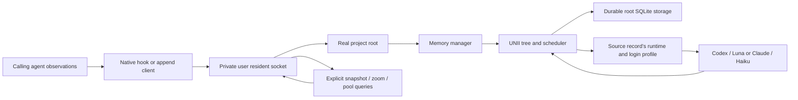

# Memory resident architecture

**Purpose:** Define capability ownership, memory scope, and operational invariants.
**Audience:** Contributors, coding agents, and integration owners.
**Status:** Implemented initial contract.
**Authority:** Maintained implementation contract derived from the user's requested scope; UNII owns its core algorithm contract.
**Expected use:** Change services or adapters without reintroducing advice machinery or splitting authoritative state.
**Lifecycle:** Update with scope, ownership, protocol, or lifetime changes; review at structural milestones and agent/Effect upgrades.

## Scope and ownership

The calling agent's real project root owns memory. Git's NUL-delimited worktree inventory identifies its primary working copy; descendants, symlinks, and linked worktrees resolve to that same physical path. Independent clones remain separate. Non-Git callers supply their physical launch root. Pool keys are permanent 256-bit identities published in a local `.slopmemr-id` file at the primary root, outside Git metadata. Paths are current locations, not identities. Relocation and initializing/removing Git preserve memory; an ordinary clone has no local identity file and gets a new key. Full filesystem copies retaining this file deliberately share identity. Do not commit it. New identities are random; a pre-existing path-keyed pool is adopted before publishing the file, preserving its key and records. Access the original location once after upgrading before moving a legacy project; a project moved before any identity file exists cannot be reliably matched automatically. The last accessed location is retained in pool metadata.

Native PostToolUse events for the installed slopmemr MCP reading methods are excluded before opening storage or launching a resident. Match the exact qualified server/tool identity; unrelated tools and other event types remain observations. Reading existing memory must not feed its responses back into that memory.

Agent runtime, session, child identity, event ID, and record kind remain provenance within a root. Deduplication uses `(runtime, session, child, event)` inside that pool. The content digest covers kind and text. Each event's complete record batch and receipt commit in one SQLite transaction before acknowledgement. Replays retain the original profile selection and receipt.

There is no review backend, advice ledger, delivery lease, or model-facing hook context. UNII's scheduler is the sole compression scheduler. The resident has a bounded set of accepted operations, not a second durable compaction queue. A disconnected client cannot cancel an accepted append or its background compression. `settle` has a bounded wait and returns the current snapshot at expiry; it does not cancel ongoing compression.

## Capability map

| Owner | Owned concept and interface | Allowed application dependencies |
| --- | --- | --- |
| `project-root` | Canonical calling-root resolution | None |
| `local-state` | OS-user private directory policy, shared by endpoints and storage | None |
| `compaction` | Login profile schema, compression port/prompt, restricted app-server adapter, capacity permits | `local-state` |
| `memory` | Intake contract, authoritative root registry, durable records/nodes/checkpoints/receipts, snapshots/zoom/status | `project-root`, `local-state`, `compaction` |
| `resident` | Wire schema, endpoint/lifetime ownership, bounded server, client | `memory` contracts, `local-state` |
| `intake` | Native hook decoding, provenance normalization, configuration generation | `memory` contract, `compaction` profile |
| `cli` | Config and process composition; command boundary | Named capabilities |

The application graph is acyclic, including type-only imports. The compaction-owned profile contract is shared at the memory/compactor seam; memory schemas do not own authentication. The filesystem policy is shared at the endpoint/storage seam; transport clients do not import storage implementation. `src/index.ts` deliberately aggregates the library surface; narrow package entrypoints preserve client/intake isolation.

`npm run architecture:check` parses static imports, re-exports, type imports, literal dynamic imports and require calls. It rejects undeclared owner edges and persistence/execution entering client or hook-normalization closures. Nonliteral dynamic imports/require calls are rejected. Tests demonstrate detection of the original reverse profile edge and SQLite transport leak.

## Durable state and lifetimes

Each pool stores `memory.sqlite` with raw records and profile references, immutable nodes, a replaceable checkpoint, event receipts, and root metadata. Data uses WAL with `synchronous=FULL`. A separate `owner.sqlite` holds an open `BEGIN IMMEDIATE` transaction for writer ownership: its OS lock is released automatically on crash, while data mutations can still commit independently. Persisted rows are schema-decoded and checked against their SQL identities; UNII validates tree/checkpoint recovery. Ambiguous or corrupt data fails visibly.

The resident uses its own SQLite lifetime lock in the private socket directory. Racing starters cannot remove each other's live socket. Only a verified stale user-owned socket is removed. Frames are limited to 2 MiB; incomplete frames have a five-second deadline. Connections and accepted operations are bounded at 64, and open root pools at 32 by default. Endpoint and provider payload errors are sanitized.

Effect layers own process resources. The server stops admission, closes sockets, and drains accepted operations before releasing memory. Memory closes UNII, which aborts compression and drains committed mutations. The compactor layer closes all live app-server process groups and scratch directories. Compaction admission uses FIFO capacity adapters over the pinned Effect partitioned semaphore. The canonical profile permit is acquired before the shared permit, so a saturated profile cannot occupy shared slots while waiting. Both backends share one global limit; there is no redundant backend gate. Defaults are 30 admitted attempts across runtimes and five per canonical login profile, shared across project roots. Released slots are reserved for existing waiters. Separate profile directories remain separate selections even if they use the same remote account; slopmemr does not infer an account identity from token stores. Capacity permits are keyed by canonical login profile and never evicted while active; at most 256 profiles are admitted per lifetime. Empty or malformed runtime configuration fails rather than silently defaulting.

## Subscription compaction

Root scope does not depend on authentication. A leaf uses its record’s captured runtime and profile (`CODEX_HOME` or `CLAUDE_CONFIG_DIR`); a parent uses its newest covered record’s runtime and profile. Runtime/profile mismatches fail, and no cross-runtime inference fallback is performed. This deterministically shares project knowledge across agents while retaining a specific login reference for every inference. Missing credentials never erase originals. Refresh and credential-store access belong to the selected native CLI, not slopmemr.

The Codex adapter forces ChatGPT login, the built-in OpenAI provider, and the Codex subscription backend. It removes API-key/token/base-URL environment overrides and checks `account/read` before inference. API-key accounts and unsupported modes fail. No login/logout RPCs are issued. Account-mode changes invalidate the worker.

The resident owns a bounded Effect resource pool for each canonical Codex profile. Each worker runs one attempt at a time and is reused after success; no connection is borrowed from the interactive agent's app-server. Pools grow lazily to the profile concurrency limit and release idle workers after five minutes. The profile registry admits at most 256 keys without eviction, so the same-sized scoped pool cache cannot evict an in-use profile. Each attempt starts in a new private scratch directory with a fresh ephemeral thread; successful threads are unsubscribed before lease release. Cancellation or failure of a leased attempt invalidates only that worker, and resident shutdown closes all pool resources. Pool-owned initialization may outlive an interrupted borrower, but has its own attempt deadline and cannot submit memory without a live lease; it may serve a later borrower or expire while idle.

Workers disable hooks, plugins, apps, MCP and execution features. Startup verifies effective restrictions and exact model availability. Every lease checks native account mode and effective restrictions again. Profile generation uses filesystem metadata for profile config/auth files and system config, without reading credential contents; changed generations or dead transports are replaced before submission. Native account-mode updates invalidate the worker. External keychain behavior remains delegated to the native runtime. Response-byte limits restart per attempt rather than accumulating across successful reuse. MCP discovery/restart occurs once per worker: an empty MCP table does not disable inherited entries. The CLI's dotted override parser does not support quoted key components, so server IDs are encoded in one TOML inline-table override and verified again. See the [auth investigation](research/compactor-auth.md).

The compression prompt distinguishes authoritative source from earlier context and retry feedback. No tools are requested or serviced; unexpected item types or server requests reject the attempt. Only a completed turn with final summary text succeeds. Submission observations and available token counters feed UNII's diagnostics and usage accounting. These controls establish the implemented restrictions, not a formal proof of every Codex feature's isolation or a semantic guarantee about generated summaries.

Claude uses subscription-only CLI auth preflight and a scoped, nonpersistent Haiku stream in a private scratch directory. It strips inherited provider/key variables, applies safe/restricted mode, disables tools/hooks/skills and MCP, validates exposed capabilities and completed model usage, and kills the entire process group on cancellation. The same shared capacity bounds both backends after runtime-specific profile admission. Claude remains a nonpersistent process per attempt; the Codex JSON-RPC reuse mechanism is not a Claude streaming-session protocol. Older Claude records with Codex-only references discard that foreign selection for inference and require an explicit Claude fallback to resume. Raw records remain intact.

## Verification boundaries

Offline tests cover real Git/worktree/clone identity; transactions, corruption and exclusive storage ownership; concurrent duplicate intake; original-text zoom; auth source selection; cancellation; real Unix-socket behavior; disconnect survival; malformed/oversized frames; competing residents; compiled CLI starter races and crash recovery; and a controlled app-server protocol with failures, auth changes, inherited MCP, usage, and capacity limits.

The [synthetic subscription run](validation/subscription-compaction.json) records one real Luna response through the current ChatGPT profile, without project content or API keys. Native hooks have generated-contract and compiled-hook tests. The live native-agent witness also exercised a real Codex/Luna session and automatic resident startup in a synthetic project; native Claude sessions and normal interactive trust acceptance remain unverified. Windows, arbitrary auth gateways, process-only credentials, live summary-quality evaluation, idle-pool eviction, and data pruning are outside the initial implementation.
